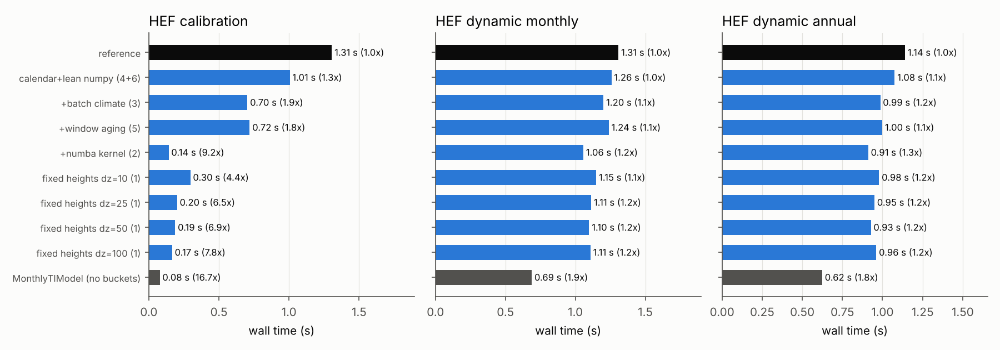
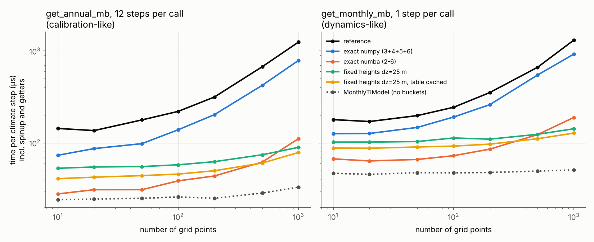
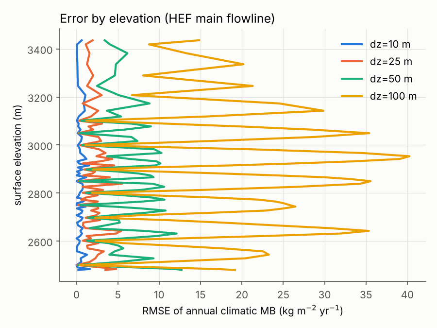
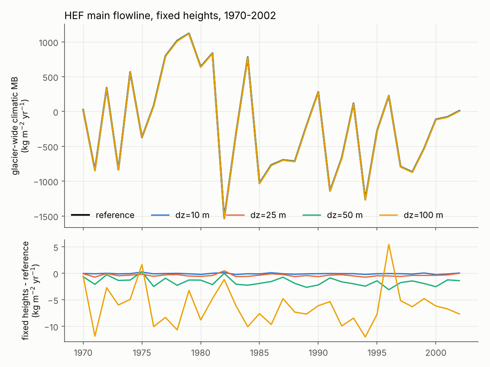
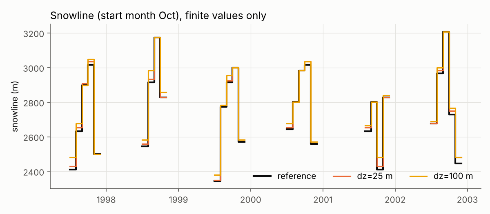
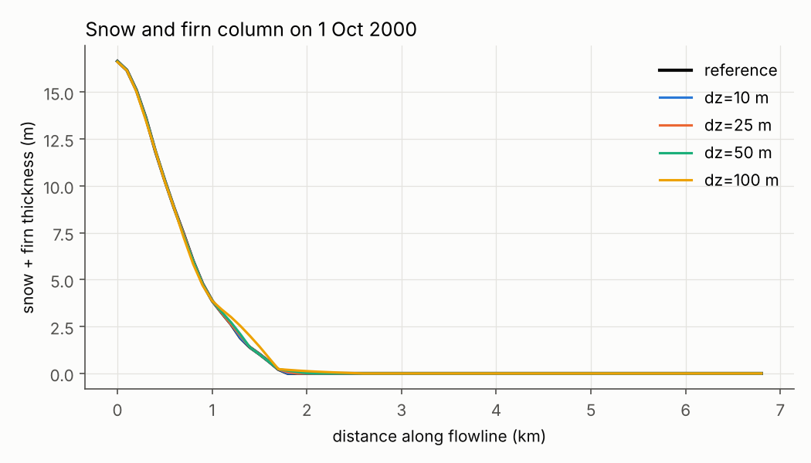
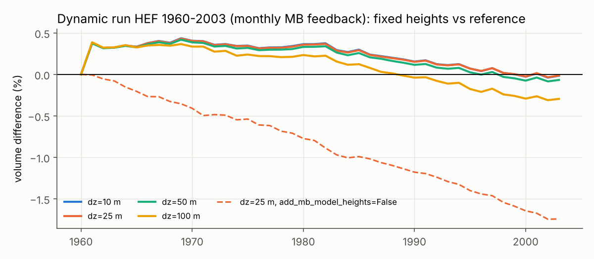

# SfcTypeTIModel performance study

**Status: EXPERIMENTAL.** This is a study, not a finished implementation.
The prototypes are in `oggm/sandbox/sfc_type_fast.py`, the scripts in
`benchmarks/sfctype/` (see [`README.md`](README.md)), and a showcase notebook
is in `sfctype_experimental_models.ipynb`.

Code base: `OGGM/oggm` master `b831160` (includes #2024, #2025 and #2026).
Machine: 4-core cloud container, 15 GB of memory, Python 3.13, numpy 2.5,
Numba 0.68. Timings are best-of-3 wall times, single process. Test case:
Hintereisferner (HEF, RGI50-11.00897) from the OGGM sample data with the
HISTALP monthly climate (3 flowlines with 13, 8 and 69 or 91 grid points).
The daily GSWP3-W5E5 test data was not reachable from the container, so
**all measured numbers are for monthly climate**. Numbers for daily climate
are extrapolations and are labelled as such.

## 1. Summary and recommendation

| | calibration HEF | dynamic run HEF (monthly MB feedback) | exact? |
|---|---|---|---|
| reference `SfcTypeTIModel` | 1.31 s | 1.31 s | – |
| exact, numpy only (ideas 3+4+5+6) | 0.72 s (**1.8×**) | 1.24 s (1.06×) | yes, 1e-12 |
| exact, Numba kernel (ideas 2–6) | 0.14 s (**9.3×**) | 1.06 s (1.24×) | yes, 1e-12 |
| fixed heights, dz = 25 m (idea 1) | 0.20 s (6.5×) | 1.11 s (1.18×) | no, see §6 |
| `MonthlyTIModel` (no buckets, lower bound) | 0.08 s | 0.69 s | – |

1. **Adopt the exact optimisations with the optional Numba kernel**
   (`FastSfcTypeTIModel`). They reproduce the reference to floating point
   precision (max. difference 5e-12 kg m⁻², calibrated `melt_f` identical to
   10 digits, the existing offline tests pass) and make the calibration about
   **9×** faster on HEF. For long flowlines the mass balance becomes
   **5–11×** faster (12 steps per call) or **3–7×** faster (one step per
   call). Without Numba the numpy path still gives **1.3–1.8×**.
2. After this, the bucket update itself is no longer the bottleneck: the
   Numba kernel needs 0.5–4 µs per step for 10–100 points, while each
   `get_monthly_mb` call still costs ~45 µs in OGGM's generic code (the same
   as for `MonthlyTIModel`). In dynamic runs on HEF, 60–75% of the time is
   ice dynamics, so the maximum possible gain for a dynamic run is about
   1.9× (the `MonthlyTIModel` time) and we reach 1.24×.
3. **The fixed-height model** (idea 1) is accurate: with dz = 25 m the annual
   climatic MB error on HEF is 2.5 kg m⁻² yr⁻¹ RMSE (glacier-wide −0.4), the
   calibrated `melt_f` differs by 0.016%, and the dynamic run differs by at
   most 0.43% in volume. For HEF-sized glaciers it is *not* faster than
   the exact Numba model, because the table covers more elevation levels
   than the glacier has grid points and the full climate period. It pays off
   for long flowlines (above about 300–500 points, see §5.2), for glaciers
   with many flowlines (one table for all of them), and when the same
   parameters are used several times (cached table). I recommend keeping it
   as an option for these cases, or for the planned daily runs (§5.5), not
   as the default.
4. Not worth it: a parameter-set dimension for calibration (idea 8: no gain,
   0.75–0.87× with Numba) and the ring buffer as a separate change (idea 5:
   1.04–1.10×). Fewer buckets (idea 7) give 1.4× (Numba) to 2.4× (numpy,
   1000 points) on the kernel only, but change the physics, so they are not
   worth it once Numba is used.

Suggested next steps for a production version: move the block runner and
the Numba kernel into `SfcTypeTIModel` (keep the numpy kernel as fallback and
reference), vectorise the daily climate in the same way as the monthly one,
and lower the per-call overhead of the mass balance getters for all models
(`sec_in_month`, `floatyear_to_date`, bisect over float-year lists), which is
now the largest single cost.

## 2. Profile of the reference model

`profile_reference.py` (instrumented timers around the parts of
`_apply_climate_step_and_aging_to_buckets`, plus cProfile for the whole run).

**Share of the SfcType model in the workflow:**

| workflow | wall time | time in climate steps | share |
|---|---|---|---|
| calibration (brentq on `melt_f`, 1970–2001, 3 flowlines, 10 872 steps) | 1.43 s | 1.33 s | **93%** |
| dynamic run 1960–2003, monthly MB feedback (1764 steps) | 1.47 s | 0.31 s (`get_monthly_mb` total: 28%) | 21% |
| dynamic run 1960–2003, annual MB feedback (1764 steps) | 1.17 s | 0.24 s | 20% |

In the dynamic runs, 90% of the cProfile time is in `FluxBasedModel.step`
(the ice dynamics).

**Split of one climate step** (µs per step; the same shares in all three
workflows):

| part | calibration | dyn. monthly | dyn. annual | share |
|---|---|---|---|---|
| climate lookup (`get_monthly_climate`) | 33.1 | 46.8 | 36.0 | 27% |
| date bookkeeping (`floatyear_to_date`, `date_to_floatyear`) | 7.7 | 10.7 | 8.3 | 6% |
| aging (`_bucket_aging`, incl. `min()`/`any()` checks) | 11.1 | 15.6 | 11.8 | 9% |
| bucket update + Python overhead (rest of the step) | 70.2 | 102.0 | 77.7 | 58% |
| **total** | **122** | **175** | **134** | |

Storing the buckets (`store_buckets`) is off by default and was not part of
these workflows. If it is on, it creates a `pandas.DataFrame` at every
stored step; storing the snowline needs the state after every step, which
prevents block processing (see §5.1).

The numbers per step agree with the micro-benchmark of the previous session
(about 40 µs of fixed numpy overhead per step plus the cost per point), but
the climate lookup and the date bookkeeping add another ~40–55 µs per step.

## 3. What was implemented

All in `oggm/sandbox/sfc_type_fast.py`, clearly marked experimental:

**`FastSfcTypeTIModel`** (subclass of `SfcTypeTIModel`, same arguments,
plus `kernel`, `batch_climate`, `window_aging`, `debug_checks`):

- *Block processing (idea 3).* The steps requested by `_run_until` and by
  the spinup are collected and processed as blocks of steps with the same
  heights (12 for `get_annual_mb`, 72 for the spinup, the whole period for
  the fixed-height table).
- *Vectorised climate (idea 3).* For `MonthlyTIModel` the climate of all
  steps of a block is computed in one 2D numpy call, with exactly the same
  arithmetic as `_get_climate_for_index` (bitwise identical). Other climate
  models (`DailyTIModel`) fall back to one call per step.
- *Precomputed calendar (idea 4).* For each step: the next bucket date,
  aging/storing flags, the climate year and month, the days and seconds per
  month. Built once per process with the same scalar functions as the
  reference.
- *Lean numpy kernel (idea 6).* No `copy()` of the buckets, no `np.clip`,
  the melt split from the melted mask and the partly melted bucket, sanity
  checks only with `debug_checks=True`.
- *Window aging (idea 5).* Aging moves a window over a padded buffer instead
  of shifting the array (numpy kernel).
- *Numba kernel (idea 2).* Loop over grid points, then steps; melting stops
  at the first bucket that is not fully melted (the cumulative sum is
  monotonic, so all older buckets are untouched); melt split and aging in
  the same loop. Numba is optional: `kernel='auto'` uses it if it is
  installed and falls back to the numpy kernel otherwise.
- *Lean getters.* `get_monthly_mb`/`get_annual_mb` use the calendar instead
  of bisecting float-year lists and cache the seconds per month/year; they
  fall back to the parent for `add_climate=True` and other special cases.
- `fl` is an explicit argument, because `MultipleFlowlineMassBalance`
  inspects the signature.

**`FixedHeightSfcTypeTIModel`** (idea 1, approximate, subclass of the above,
plus `dz`, `z_range`, `z_margin`, `share_table`, `add_mb_model_heights`):

- The buckets are tracked on fixed elevation levels with spacing `dz`, from
  the lowest bed of all model flowlines minus 100 m to the highest surface
  plus 300 m (70 levels for HEF with dz = 25 m).
- At the first request after an (re)initialisation, a hidden
  `FastSfcTypeTIModel` on the levels runs the spinup and **all** years up to
  the end of the climate data in **one block** (one vectorised climate call
  and one kernel call). It stores a table (steps × levels) of climatic MB,
  ice MB, snow/firn/ice melt, column mass and thickness, and a snowline
  signal.
- Every mass balance request then linearly interpolates the table rows to the
  requested heights and fills the same per-grid-point arrays as the
  reference, so all getters (`get_annual_mb`, `get_annual_melt`,
  `climatic_mb`, ...) work unchanged.
- The table is cached and shared between instances with the same glacier,
  parameters and levels (all flowlines of a glacier, repeated calibration
  steps with the same parameters). The hidden level models are reused too.
- Negative bucket contents never enter the buckets. The snowline uses a
  signed signal per level: the snow mass of the snowline buckets where
  there is snow, minus the melt potential of the step where there is none.
  It is interpolated to the grid points, and then the rule of the reference
  is applied (lowest grid point with snow).
- `add_mb_model_heights=True` (default): with `include_mb_model_heights`
  (the default of the flowline models), the table is read at
  surface + snow/firn column, like the reference evaluates its climate there.
- Not supported in the prototype: `spinup_buckets`, `save_to_file`, the full
  bucket state per grid point (`mb_buckets_np`), except through
  `store_buckets` (interpolated from the levels).

**Not implemented** (estimated with kernel-only benchmarks, §5.4): idea 7
(fewer buckets), idea 8 (parameter-set dimension), idea 9 (spinup reuse,
see §5.4).

## 4. Exactness of the exact variants

`check_exact.py` compares all outputs of `FastSfcTypeTIModel` with the
reference (climatic MB, ice MB, snow/firn/ice melt, heights, final buckets,
bucket date, stored buckets, snowline) for:

- 5 configurations (default; monthly storing + snowline; annual aging; annual
  aging + annual storing + snowline from June; no spinup storing + linear
  melt factor and density + 3 spinup years) × numpy/Numba kernel ×
  batched/per-step climate × window/shift aging, with fixed heights for 20
  years and changing heights with monthly calls for 12 years;
- annual climate resolution;
- the HEF calibration (all three flowlines);
- the HEF dynamic runs with monthly and annual MB feedback (all flowlines,
  volume and length with `rtol=1e-10`).

All checks pass with `rtol=1e-12, atol=1e-9 kg m-2`. The largest difference
in the climatic MB is 5.2e-12 kg m⁻²; it comes from a different summation
order (the reference computes it as the change of the bucket sum, the fast
model as solid precipitation minus melt). The calibrated `melt_f` is
identical (9.8028721258 in both). The ice MB, buckets, snowline and stored
buckets are identical within the same tolerance.

The existing tests were run with the fast class swapped in
(`pytest_fast_plugin.py`, both kernels, `-k sfc --run-slow`): the same 5
tests pass and the same 4 tests fail as with the unmodified model; the 4
failures all need daily GSWP3-W5E5 data from `cluster.klima.uni-bremen.de`,
which was not reachable. The core code is unchanged, so the normal test suite
is not affected.

## 5. Speed

### 5.1 HEF workflows

`bench_speed.py`, section `hef` (cumulative variants):

| variant | calibration | dyn. monthly feedback | dyn. annual feedback |
|---|---|---|---|
| reference | 1.31 s | 1.31 s | 1.14 s |
| + calendar, lean numpy kernel (4+6) | 1.01 s (1.3×) | 1.26 s | 1.08 s |
| + batched climate (3) | 0.70 s (1.9×) | 1.20 s | 0.99 s |
| + window aging (5) | 0.72 s (1.8×) | 1.24 s | 1.00 s |
| + Numba kernel (2) | **0.14 s (9.3×)** | 1.06 s (1.24×) | 0.91 s (1.25×) |
| fixed heights dz = 10 m | 0.30 s (4.4×) | 1.15 s | 0.98 s |
| fixed heights dz = 25 m | 0.20 s (6.5×) | 1.11 s | 0.95 s |
| fixed heights dz = 50 m | 0.19 s (6.9×) | 1.10 s | 0.93 s |
| fixed heights dz = 100 m | 0.17 s (7.9×) | 1.11 s | 0.96 s |
| `MonthlyTIModel` (no buckets) | 0.08 s | 0.69 s | 0.62 s |

The dynamic runs vary by ±5% between repetitions; differences below that are
noise. Numba compiles the kernel at the first call (about 0.8 s once, then
cached on disk; loading from the cache takes about 0.15 s per process).

With storing of the snowline (or of the buckets at every step) the state is
needed after every step, so the blocks are split into single steps. The
notebook shows the effect on HEF (1970–2002, main flowline): 2.6× instead of
5.6× with Numba.

### 5.2 Scaling with the number of grid points

HEF main flowline resampled to n points (same glacier, finer `dx`),
spinup + 1970–2001, time per climate step including spinup and getters:

`get_annual_mb`, 12 steps per call (calibration-like), µs per step:

| n points | reference | exact numpy | exact Numba | fixed dz=25 | fixed, table cached | MonthlyTIModel |
|---|---|---|---|---|---|---|
| 10 | 144 | 73 (2.0×) | 28 (**5.1×**) | 53 (2.7×) | 41 | 24 |
| 50 | 178 | 98 (1.8×) | 31 (5.7×) | 55 (3.2×) | 44 | 25 |
| 100 | 220 | 139 (1.6×) | 39 (5.6×) | 58 (3.8×) | 46 | 26 |
| 200 | 316 | 203 (1.6×) | 44 (7.2×) | 62 (5.1×) | 50 | 25 |
| 500 | 675 | 424 (1.6×) | 62 (10.9×) | 74 (9.1×) | 60 | 28 |
| 1000 | 1251 | 790 (1.6×) | 111 (11.3×) | 89 (**14.1×**) | 79 | 33 |

`get_monthly_mb`, one step per call with changing heights (dynamics-like),
µs per step:

| n points | reference | exact numpy | exact Numba | fixed dz=25 | fixed, table cached | MonthlyTIModel |
|---|---|---|---|---|---|---|
| 10 | 179 | 126 (1.4×) | 67 (**2.7×**) | 102 (1.8×) | 88 | 47 |
| 50 | 198 | 147 (1.3×) | 66 (3.0×) | 103 (1.9×) | 90 | 47 |
| 100 | 244 | 191 (1.3×) | 73 (3.3×) | 113 (2.2×) | 92 | 47 |
| 200 | 353 | 261 (1.4×) | 86 (4.1×) | 110 (3.2×) | 97 | 48 |
| 500 | 666 | 549 (1.2×) | 123 (5.4×) | 124 (5.4×) | 111 | 49 |
| 1000 | 1316 | 926 (1.4×) | 189 (7.0×) | 143 (**9.2×**) | 128 | 51 |

So:

- the exact Numba model is the fastest up to about 300–500 points, i.e. for
  nearly all glaciers;
- the fixed-height model has an almost constant cost per step (its table has
  70 levels, whatever the number of grid points) and wins for very long
  flowlines; its cost is dominated by the table (spinup plus all years up to
  the end of the climate data, here 2002) and by the interpolation;
- all variants approach the floor set by the generic per-call cost of OGGM's
  mass balance getters (the `MonthlyTIModel` line), about 25 µs per step
  with 12 steps per call and about 45 µs per call with one step per call.

**Bucket update alone** (`kernel` section, synthetic data, 72 + 1 buckets, µs
per step):

| n points | numpy kernel | Numba kernel |
|---|---|---|
| 10 | 37.5 | 0.48 |
| 100 | 96.6 | 4.0 |
| 1000 | 751 | 52 |

The numpy kernel has about 35 µs of fixed overhead per step (about 30 small
numpy calls). The Numba kernel is 15–80× faster, mainly because it stops at
the first bucket that is not fully melted.

### 5.3 Dynamic runs on longer and finer flowlines

One synthetic constant-slope glacier over the HEF elevation range (3700 to
2100 m over 14 km), 1980–2003, monthly MB feedback, `FluxBasedModel`:

| n points (dx) | reference | exact numpy | exact Numba | fixed dz=25 | MonthlyTIModel |
|---|---|---|---|---|---|
| 70 (200 m) | 0.117 s | 0.095 s | 0.059 s (2.0×) | 0.074 s (1.6×) | 0.038 s |
| 140 (100 m) | 0.177 s | 0.144 s | 0.091 s (1.9×) | 0.118 s (1.5×) | 0.067 s |
| 280 (50 m) | 0.383 s | 0.361 s | 0.243 s (1.6×) | 0.243 s (1.6×) | 0.179 s |
| 560 (25 m) | 1.345 s | 1.274 s | 1.119 s (1.2×) | 1.071 s (1.3×) | 0.833 s |

With finer `dx` the dynamics need smaller time steps and dominate more and
more, so the gain of any mass balance optimisation shrinks.

### 5.4 Ideas not implemented (kernel-only estimates)

`bench_ideas_estimates.py`:

- **Idea 7, fewer buckets** (17 instead of 72): numpy kernel 1.03× (10
  points) to 2.4× (1000 points), Numba kernel 1.15–1.47×. With Numba the
  kernel only touches the first few buckets anyway. Changes the melt factor
  and density resolution of older firn. Not recommended.
- **Idea 8, parameter-set dimension** (N parameter sets as N × n rows of one
  kernel call): numpy 1.36× (69 points, N = 10) down to 0.84× (300 points);
  Numba 0.75–0.87×, i.e. slower (the loop over points has no fixed cost to
  amortise, and the larger arrays fall out of the cache). It would also need
  a grid-search instead of brentq. Not recommended. The cheap way to speed up
  calibration is the faster model itself, or the cached fixed-height table.
- **Idea 5, ring buffer** (window aging, numpy kernel only): 1.04× (10
  points) to 1.10× (1000 points). Implemented as an option, but marginal.
- **Idea 9, reuse of the spinup**: in the brentq calibration every iteration
  has different parameters, so a spinup can not be reused. With the fast
  model the spinup (72 steps in one block) costs about the same as 6 years
  of the run, so there is little to gain. A cache would only help when
  exactly the same parameters are evaluated again (this is what the
  fixed-height table cache does).

### 5.5 Daily climate (extrapolation, not measured)

With daily climate there are about 30× more steps per year. For the
reference the cost per step is about the same, so a HEF calibration would
take about 30–40 s. For the fast model:

- the kernel with blocks of 365 steps costs the same per step as with 12
  steps (measured: 0.5–3.4 µs for 10–100 points with Numba, §5.2 table
  `kernel nt=365` in `results/bench_speed.json`);
- **but** the prototype vectorises only the `MonthlyTIModel` climate;
  `DailyTIModel` falls back to one `get_daily_climate` call per step
  (~35–45 µs). With this fallback the expected gain is about 3–4×; with a
  vectorised daily climate (same approach, not done) the per-step cost would
  be a few µs and the expected gain 20–30× for the calibration;
- the precomputed calendar removes the daily `floatyear_to_date` calls
  (3 per step in the reference) entirely.

## 6. Accuracy of the fixed-height model

`accuracy_fixed_heights.py`. Static case: HEF main model flowline (91
points, 74 with ice), heights fixed (like in a calibration), monthly calls
1970–2002, buckets stored monthly, snowline stored. Statistics over all
glacier points and time steps (bias / RMSE).

| quantity | dz = 10 m | dz = 25 m | dz = 50 m | dz = 100 m |
|---|---|---|---|---|
| climatic MB, monthly, RMSE (kg m⁻²) | 0.19 | 0.72 | 2.0 | 5.7 |
| climatic MB, annual, bias / RMSE (kg m⁻² yr⁻¹) | −0.07 / 0.6 | −0.35 / 2.5 | −1.3 / 6.8 | −4.9 / 21.8 |
| climatic MB, annual glacier-wide, bias / RMSE | −0.07 / 0.12 | −0.38 / 0.45 | −1.6 / 1.8 | −6.2 / 7.3 |
| ice MB, annual, bias / RMSE | −0.06 / 4.8 | −0.38 / 17.5 | −1.0 / 44 | −4.1 / 95 |
| ice MB, annual glacier-wide, bias / RMSE | −0.07 / 0.54 | −0.53 / 1.7 | −1.7 / 5.8 | −6.5 / 27 |
| snow melt, annual, bias / RMSE | −0.1 / 0.9 | −0.3 / 4.4 | −1.0 / 10.6 | −3.4 / 23.8 |
| firn melt, annual, bias / RMSE | 0.0 / 3.0 | 0.3 / 12.9 | 0.5 / 30.7 | 1.3 / 59.5 |
| ice melt, annual, bias / RMSE | 0.1 / 3.1 | 0.4 / 12.9 | 1.9 / 31.0 | 7.5 / 65.1 |
| single bucket mass, RMSE (kg m⁻²) | 1.0 | 3.3 | 6.8 | 13.4 |
| single bucket thickness, RMSE (m) | 0.001 | 0.004 | 0.008 | 0.017 |
| snow + firn column thickness, RMSE (m) | 0.004 | 0.016 | 0.043 | 0.115 |
| mean column density, RMSE (kg m⁻³) | 1.9 | 4.5 | 11 | 21 |
| snowline, bias / RMSE (m) | 2.0 / 5.7 | 3.5 / 7.9 | 6.5 / 14 | 8.6 / 20 |
| snowline identical to the reference | 83% | 76% | 71% | 70% |
| calibrated `melt_f` (reference 9.80287) | 9.80263 (−0.003%) | 9.80132 (−0.016%) | 9.79614 (−0.07%) | 9.77759 (−0.26%) |
| dynamic run: max. volume difference | 0.44% | 0.43% | 0.42% | 0.39% |
| dynamic run: volume difference in 2003 | −0.02% | −0.01% | −0.07% | −0.30% |
| dynamic run: max. area / length difference | 0.13% / 1 grid point | 0.11% / 1 gp | 0.10% / 1 gp | 0.07% / 1 gp |

Remarks:

- The errors converge with dz (between dz^1.5 and dz², linear interpolation
  of a profile with kinks). The ice MB has larger point errors than the
  climatic MB; a likely reason is that it also contains the newly formed ice
  from the oldest firn bucket, which switches on and off where the firn is
  used up.
- Error by elevation: zero at the levels and largest between them (the
  zigzag in the figure); the largest values are around 2900–3100 m, near the
  equilibrium line of HEF, where the buckets switch between "some firn left"
  and "all melted" within a few tens of metres.

  

- Glacier-wide annual climatic MB:

  

- Snowline: the reference snowline is the height of the lowest grid point
  with snow, so it jumps by whole grid points (100 m along the flowline,
  about 15 m in height on average); a difference of one grid point is
  common for all dz.

  

- Snow and firn column:

  

- **Dynamic run** (`run_from_climate_data`, 1960–2003, monthly feedback):

  

  The volume difference does *not* shrink with dz: it is caused by the
  physics change (the state belongs to elevation levels), not by the
  interpolation. In the first year the difference is in the firn volume
  (+2.6%): the reference's spinup is done at the ice surface, while the
  fixed-height lookup at surface + firn reads levels whose whole history,
  spinup included, was at that height. Later the ice volume differs by up to
  0.43% (around 1980), and the difference is back to ~0 by 2003. Lengths
  differ by at most one grid point at single dates.
- `include_mb_model_heights`: if the fixed-height model ignores the
  snow/firn column (`add_mb_model_heights=False`), the volume differs by
  −1.75% at the end, about the same as the reference model run without
  `include_mb_model_heights` (−1.85%). Honouring it (the default) is
  therefore the better match.

**Physics change to keep in mind:** in the fixed-height model a grid point
that thins takes on the snow and firn of the lower level, and a grid point
that thickens takes on the state of the higher level; snow and firn mass is
not conserved per grid point. For HEF 1960–2003 the effect on volume is
below 0.5%, but it will be larger for fast-changing glaciers (strong thinning
or surges).

**Speed versus accuracy:** dz = 25 m is a good compromise (annual error a
few kg m⁻² yr⁻¹, glacier-wide < 0.5 kg m⁻² yr⁻¹). The table cost grows
with the number of levels, so going below 10 m makes the table cost
noticeable (see the notebook: 50 ms for dz = 5 m vs 26 ms for dz = 25 m,
both including the spinup and the HEF main flowline requests).

## 7. Limitations of this study

- Only monthly climate (HISTALP) could be used; daily numbers are
  extrapolated (§5.5).
- One glacier (HEF) plus resampled and synthetic flowlines; no RGI-wide run.
- Timings in a shared cloud container, ±5% noise.
- The prototypes are not wired into OGGM: no `save_to_file` for the
  fixed-height model, `spinup_buckets` is not supported by it, and the
  hidden level model reads the climate once more.
- `test_repr_daily_and_sfc_type`, `test_sfc_type_mb_model`,
  `test_sfc_type_mb_model_calib_dynamics` and
  `test_sfc_type_mass_conservation` need data that was not reachable; they
  fail for the reference and the fast model alike.

## 8. Files

- `oggm/sandbox/sfc_type_fast.py`: prototypes (`FastSfcTypeTIModel`,
  `FixedHeightSfcTypeTIModel`, the numpy and Numba kernels).
- `benchmarks/sfctype/*.py`: scripts (see `README.md`).
- `benchmarks/sfctype/results/`: JSON results, cProfile dumps, figures.
- `benchmarks/sfctype/sfctype_experimental_models.ipynb`: showcase notebook.
